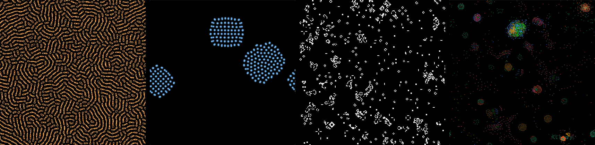

# notml

[](https://github.com/djcopp/notml/actions/workflows/ci.yml)
[](LICENSE)

Simulations written as ONNX graphs and run in the browser by onnxruntime-web. Each one is a few kilobytes
of ONNX, built in Python, and steps a world of up to four million cells on WebAssembly or WebGPU. The page
also runs the same rules written in plain JavaScript, and shows a table of what it measured on your device.

**[Open the gallery](https://djcopp.github.io/notml/)**



## How fast is it?

It depends on the simulation, the engine and the device, so the page measures it for you. In my runs (Chromium,
Apple M5), the pattern was consistent even though the exact numbers moved a lot between runs:

- **Lenia is where ONNX wins big:** 40 to 130 steps per second against about 0.6 in plain JavaScript. Every
  cell reads 729 neighbours, which onnxruntime runs as one dense convolution and JavaScript does one
  multiply at a time.
- **Game of Life and reaction–diffusion:** from roughly level to a few times faster than JavaScript. These
  stencils are only 9 cells wide, and a tight JavaScript loop is already quick.
- **Particle Life is slower as ONNX.** Every pair of particles interacts, so each step builds several
  16.7-million-element tensors, one operation at a time. onnxruntime-web doesn't fuse operations, and a
  JavaScript loop that keeps each pair's maths in registers wins.

Multithreaded WebAssembly needs the page to be cross-origin isolated. The gallery adds the headers with a
small service worker, which takes effect after the first reload. Until then WASM runs on one thread and is
much slower.

## Use it

```bash
pip install "notml @ git+https://github.com/djcopp/notml"
```

```python
import onnx
from notml import sims

onnx.save(sims.lenia(512, 512, steps=4), "lenia.onnx")  # input "world": float32 [1, 1, 512, 512] in [0, 1]
onnx.save(sims.life(2048, 2048, steps=32), "life.onnx")  # input "cells": float32 [1, 1, 2048, 2048], 0 or 1
```

Each model takes the current state and returns it advanced by `steps`, plus a `uint8` image ready to draw,
so a page calls it once per frame and feeds the state back in. With the WebGPU backend, setting
`preferredOutputLocation: "gpu-buffer"` keeps the state on the GPU between calls.

| builder | state | per step |
|---|---|---|
| `sims.life(h, w, steps)` | `cells` `[1, 1, h, w]` | one 3 × 3 convolution, then `Abs` and `Clip` |
| `sims.gray_scott(h, w, steps, feed, kill)` | `uv` `[1, 2, h, w]` | a depthwise Laplacian and the reaction terms |
| `sims.lenia(h, w, steps, radius, mu, sigma, dt)` | `world` `[1, 1, h, w]` | a ring-shaped convolution and a growth curve |
| `sims.particle_life(n, types, steps)` | `pos`, `vel` `[n, 2]`, `kind`, `rules` | all-pairs forces |

Every grid wraps at the edges. Each builder is tested against a plain numpy version of the same rules.

The Game of Life compiles to one convolution per step. With v = neighbours + cell / 2, a cell is alive
next step exactly when 2.5 ≤ v ≤ 3.5. So a 3 × 3 kernel with centre weight 1, neighbour weight 2 and bias
-6 computes u = 2v - 6, and the next state is clip(2 - |u|, 0, 1).

## Also in this repo

- **`notml.regex`** compiles a regular expression into an ONNX graph that checks a whole batch of strings
  at once. It is correct, and only slightly faster than JavaScript's own `RegExp` in the browser.
- **[Findings](docs/findings.md)** from the survey that started notml: eight non-ML workloads (SQL, regex,
  physics, graphs, finance, a virtual machine) raced against numpy, SciPy, DuckDB and others, natively and
  in the browser, including where ONNX loses and why.
- Three bugs found along the way, with fixes submitted upstream:
  [microsoft/onnxruntime#34274](https://github.com/microsoft/onnxruntime/pull/34274),
  [microsoft/onnxruntime#34275](https://github.com/microsoft/onnxruntime/pull/34275) and
  [microsoft/onnxscript#3221](https://github.com/microsoft/onnxscript/pull/3221).

## Development

```bash
uv sync
uv run pytest
uv run ruff check . && uv run ruff format --check .
uv run python scripts/build_gallery.py                       # models for gallery/
uv run python -m lab serve                                   # serve the survey's browser bench
uv run playwright install chromium                           # once, for the two benchmarks below
uv run python scripts/bench_gallery.py --json docs/results/gallery.json
uv run python -m lab run && uv run python -m lab web && uv run python -m lab browser   # the survey
uv run python scripts/figures.py
```

## Licence

MIT
