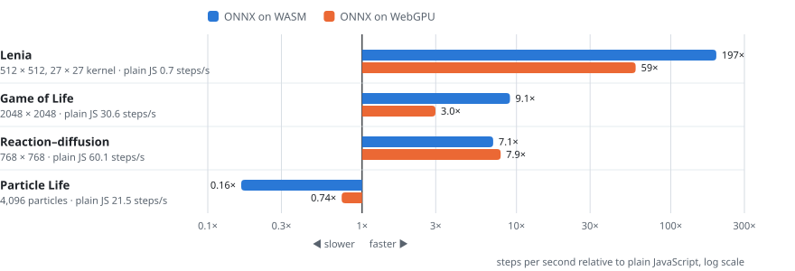

# notml

[](https://github.com/djcopp/notml/actions/workflows/ci.yml)
[](LICENSE)

Simulations written as ONNX graphs and run in the browser by onnxruntime-web. Each one is a few kilobytes
of ONNX, built in Python, and steps a world of up to four million cells on WebAssembly or WebGPU. Against
the same rules written in plain JavaScript, the ONNX version of Lenia runs **197 times faster**.

**[Open the gallery](https://djcopp.github.io/notml/)**


## Speed

Steps per second in Chromium on an Apple M5, the same rules in each engine:

<picture>
  <source media="(prefers-color-scheme: dark)" srcset="docs/img/gallery-dark.svg">
  
</picture>

| simulation | world | ONNX on WASM | ONNX on WebGPU | plain JavaScript |
|---|---|---:|---:|---:|
| Lenia | 512 × 512, 27 × 27 kernel | 130 | 39 | 0.66 |
| Game of Life | 2048 × 2048 | 277 | 91 | 31 |
| Gray–Scott reaction–diffusion | 768 × 768, two chemicals | 424 | 474 | 60 |
| Particle Life | 4,096 particles, all pairs | 3.5 | 16 | 22 |

The three grid simulations are convolutions, and onnxruntime turns a convolution into the kind of dense
matrix work its kernels are tuned for. Lenia gains the most because each cell reads 729 neighbours, which
hand-written JavaScript does one multiply at a time.

Particle Life is the counterexample. Every pair of particles interacts, so each step builds several
16.7-million-element tensors, one operation at a time. onnxruntime-web doesn't fuse operations, so
that memory traffic costs more than a JavaScript loop that keeps each pair's maths in registers.

WebAssembly beats WebGPU on most of these. onnxruntime-web's WASM backend runs its convolutions on every
core with SIMD, while its WebGPU convolution is slow for single-channel images and large kernels. WASM only
gets all the cores when the page is cross-origin isolated; the gallery adds the required headers with a
small service worker, so it works on GitHub Pages too.

## Use it

```bash
pip install "notml @ git+https://github.com/djcopp/notml"
```

```python
import onnx
from notml import sims

onnx.save(sims.lenia(512, 512, steps=4), "lenia.onnx")  # input "world": float32 [1, 1, 512, 512] in [0, 1]
onnx.save(sims.life(2048, 2048, steps=32), "life.onnx")  # input "cells": float32 [1, 1, 2048, 2048], 0 or 1
```

Each model takes the current state and returns it advanced by `steps`, plus a `uint8` image ready to draw,
so a page calls it once per frame and feeds the state back in. With the WebGPU backend, setting
`preferredOutputLocation: "gpu-buffer"` keeps the state on the GPU between calls.

| builder | state | per step |
|---|---|---|
| `sims.life(h, w, steps)` | `cells` `[1, 1, h, w]` | one 3 × 3 convolution, then `Abs` and `Clip` |
| `sims.gray_scott(h, w, steps, feed, kill)` | `uv` `[1, 2, h, w]` | a depthwise Laplacian and the reaction terms |
| `sims.lenia(h, w, steps, radius, mu, sigma, dt)` | `world` `[1, 1, h, w]` | a ring-shaped convolution and a growth curve |
| `sims.particle_life(n, types, steps)` | `pos`, `vel` `[n, 2]`, `kind`, `rules` | all-pairs forces |

Every grid wraps at the edges. Each builder is tested against a plain numpy version of the same rules.

The Game of Life compiles to one convolution per step. With v = neighbours + cell / 2, a cell is alive
next step exactly when 2.5 ≤ v ≤ 3.5. So a 3 × 3 kernel with centre weight 1, neighbour weight 2 and bias
-6 computes u = 2v - 6, and the next state is clip(2 - |u|, 0, 1).

## Also in this repo

- **`notml.regex`** compiles a regular expression into an ONNX graph that checks a whole batch of strings
  at once. It is correct, and only slightly faster than JavaScript's own `RegExp` in the browser.
- **[Findings](docs/findings.md)** from the survey that started notml: eight non-ML workloads (SQL, regex,
  physics, graphs, finance, a virtual machine) raced against numpy, SciPy, DuckDB and others, natively and
  in the browser, including where ONNX loses and why.
- Three bugs found along the way, with fixes submitted upstream:
  [microsoft/onnxruntime#34274](https://github.com/microsoft/onnxruntime/pull/34274),
  [microsoft/onnxruntime#34275](https://github.com/microsoft/onnxruntime/pull/34275) and
  [microsoft/onnxscript#3221](https://github.com/microsoft/onnxscript/pull/3221).

## Development

```bash
uv sync
uv run pytest
uv run ruff check . && uv run ruff format --check .
uv run python scripts/build_gallery.py                       # models for gallery/
uv run python -m lab serve                                   # serve the survey's browser bench
uv run playwright install chromium                           # once, for the two benchmarks below
uv run python scripts/bench_gallery.py --json docs/results/gallery.json
uv run python -m lab run && uv run python -m lab web && uv run python -m lab browser   # the survey
uv run python scripts/figures.py
```

## Licence

MIT
