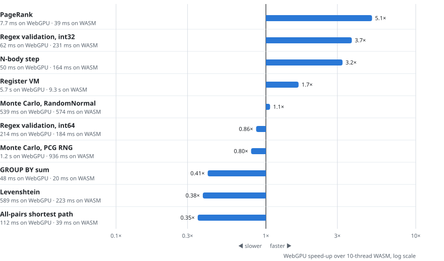
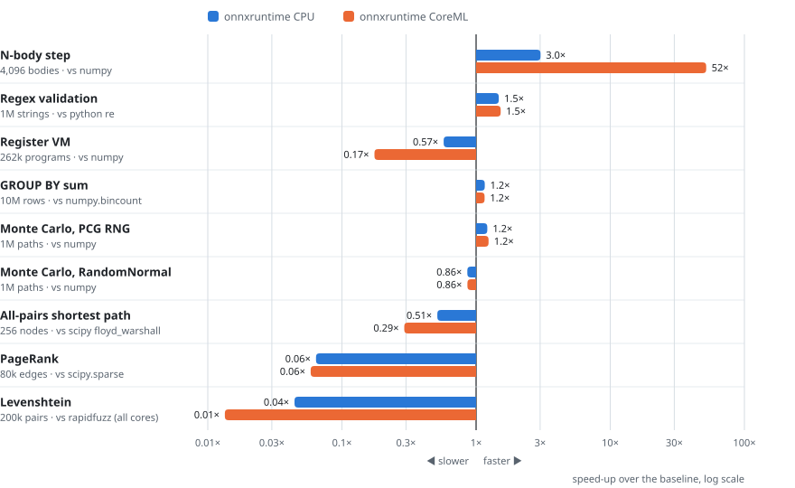
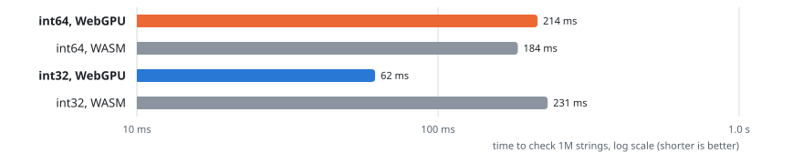
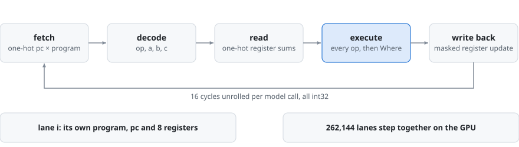

# Findings: ordinary workloads as ONNX graphs

Before the gallery, notml started as a survey: eight workloads that aren't machine learning (a SQL
aggregate, regex validation, an N-body step, PageRank, shortest paths, an option pricer, fuzzy string
matching and a small virtual machine), each written as an ONNX graph and raced against the library people
normally use, natively and in the browser. This page collects what that showed. Every number, with the
method, is in [results.md](results.md).

## Regular expressions compiled to ONNX

`notml.regex` compiles a pattern into a minimal DFA and then into a graph of table lookups over uint8
input. It agrees with Python's `re.fullmatch` on every test pattern. Against the browser's own `RegExp` on
a million strings, WebGPU is 1.1 to 1.6 times faster for short fields (emails, timestamps, UUIDs) and slower
on long log lines. JavaScript's regex engine compiles to machine code, while onnxruntime-web runs each graph
op as a separate GPU pass, so the margin stays small. The log-depth "scan" variant, which composes
per-character transition functions in a tree, needs states × length memory per string and loses
everywhere it fits.

## In the browser

The same files in onnxruntime-web, WebGPU against WASM with all 10 threads. Both run in the same tab, so
this is the choice a web app actually faces.

<picture>
  <source media="(prefers-color-scheme: dark)" srcset="img/browser-dark.svg">
  
</picture>

Workloads that do a lot of independent arithmetic per element get 3-5× from the GPU: PageRank over 80,000
edges, checking a million strings against a regex, and an N-body step. Workloads that are mostly
scattered writes (GROUP BY), long chains of small dependent steps (Levenshtein's dynamic program) or a
poor algorithmic fit for tensors (all-pairs shortest paths) are faster on the CPU.

## Natively

Against the library you would normally reach for, on the same Mac:

<picture>
  <source media="(prefers-color-scheme: dark)" srcset="img/native-dark.svg">
  
</picture>

On the CPU, onnxruntime behaves like a good numpy: 1.2-3× faster where it can fuse and multithread
elementwise maths, and well behind specialised libraries (rapidfuzz, SciPy's sparse routines) or better
algorithms (Floyd-Warshall instead of repeated min-plus squaring). The large native win is the N-body step
on Apple's GPU through CoreML: 52× faster than numpy, and faster than the same model in PyTorch on MPS.

## Integer width decides whether WebGPU helps

WebGPU has no 64-bit integers, and PyTorch's exporter uses int64 for anything index-like. The regex DFA
shows what that costs. The int64 version is no faster on WebGPU than on the CPU. The same graph with int32
states and characters is 3.5× faster on WebGPU, and 3.7× faster than WASM.

<picture>
  <source media="(prefers-color-scheme: dark)" srcset="img/int-width-dark.svg">
  
</picture>

Getting an int32 graph out of PyTorch takes care: `int32.sum()` silently promotes to int64, and int32
tensor indexing exports an invalid model (fixed in microsoft/onnxscript#3221).

## A virtual machine inside a graph

Can a graph run arbitrary programs, branches and all? [`experiments/vm.py`](../experiments/vm.py) compiles a
small register machine into ONNX: 11 instructions, 8 registers, 16-instruction programs. Every lane has its
own program counter, registers and code, so a single call steps hundreds of thousands of unrelated
programs at once.

<picture>
  <source media="(prefers-color-scheme: dark)" srcset="img/vm-dark.svg">
  
</picture>

The demo runs 262,144 programs for 192 cycles, half computing GCDs and half counting Collatz steps. Every
lane matches a reference interpreter. WebGPU takes 5.7 s and WASM 9.3 s; natively, a vectorised numpy
interpreter takes 2.4 s. So it works, and it is not fast yet. Branch-free fetch and decode touch the whole
program and register file on every cycle, which comes to about 1,300 nodes per call.

Every number, with the method behind it, is in [results.md](results.md).

## Takeaways

- **Portability is the reason to do this, not CPU speed.** On a CPU, onnxruntime is roughly as fast as
  numpy. The gains come from running one file on a GPU you don't otherwise have easy access to, and above
  all a GPU inside a browser tab.
- **The shape of the work matters more than the runtime.** Wide, independent, arithmetic-heavy work wins.
  Scatters, long chains of tiny dependent ops, and problems where a CPU library uses a smarter algorithm
  lose, by up to 70×.
- **Check every answer.** Two of the fastest results in this repo were wrong: a multithreaded `ScatterND`
  that lost updates, and a GPU-friendly random number generator that priced options 14% low.
- **Randomness is the awkward part.** `RandomNormalLike` runs on the CPU under GPU providers. A
  counter-based generator built from integer ops fixes that natively, but onnxruntime-web's WebGPU
  provider lacks the bitwise kernels it needs, and the bit-op-free substitute is biased.

## Bugs found on the way

Pushing these runtimes outside their usual workloads turned up three bugs. Fixes are submitted upstream:

| where | what goes wrong | fix |
|---|---|---|
| onnxruntime CPU | `ScatterND` with a reduction loses updates under multithreading; sums come out 11-13% low | [microsoft/onnxruntime#34274](https://github.com/microsoft/onnxruntime/pull/34274) |
| onnxruntime CoreML | a `Conv` with no `pads` attribute (valid ONNX) fails to compile as an ML Program | [microsoft/onnxruntime#34275](https://github.com/microsoft/onnxruntime/pull/34275) |
| PyTorch exporter | int32 tensor indexing exports an invalid `GatherND` | [microsoft/onnxscript#3221](https://github.com/microsoft/onnxscript/pull/3221) |

Two gaps without fixes yet: onnxruntime-web's WebGPU provider has no kernels for `BitShift`,
`BitwiseXor` or `Range`, and onnxruntime-web 1.30 rejects files stamped with the IR version that current
`onnx` releases write (pin `ir_version = 9`).

